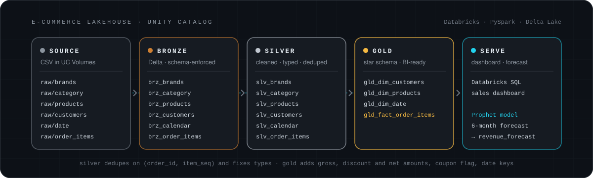
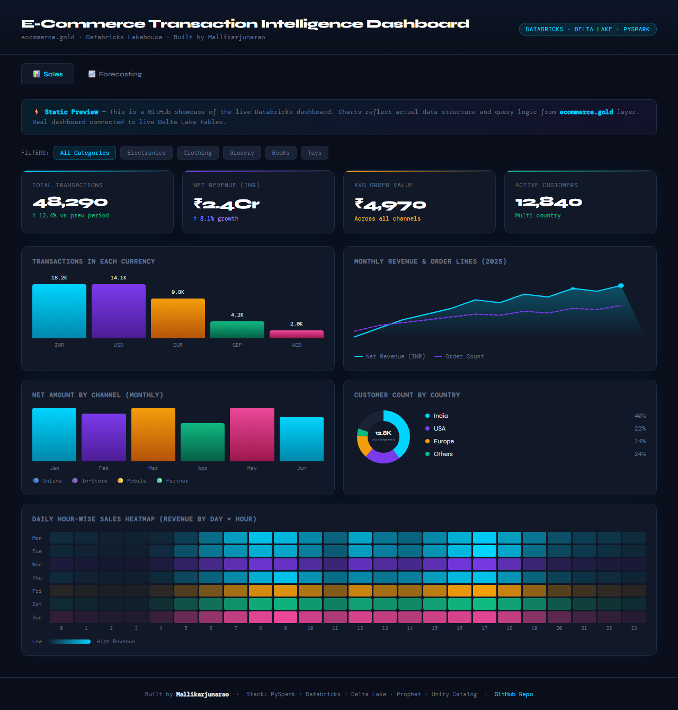
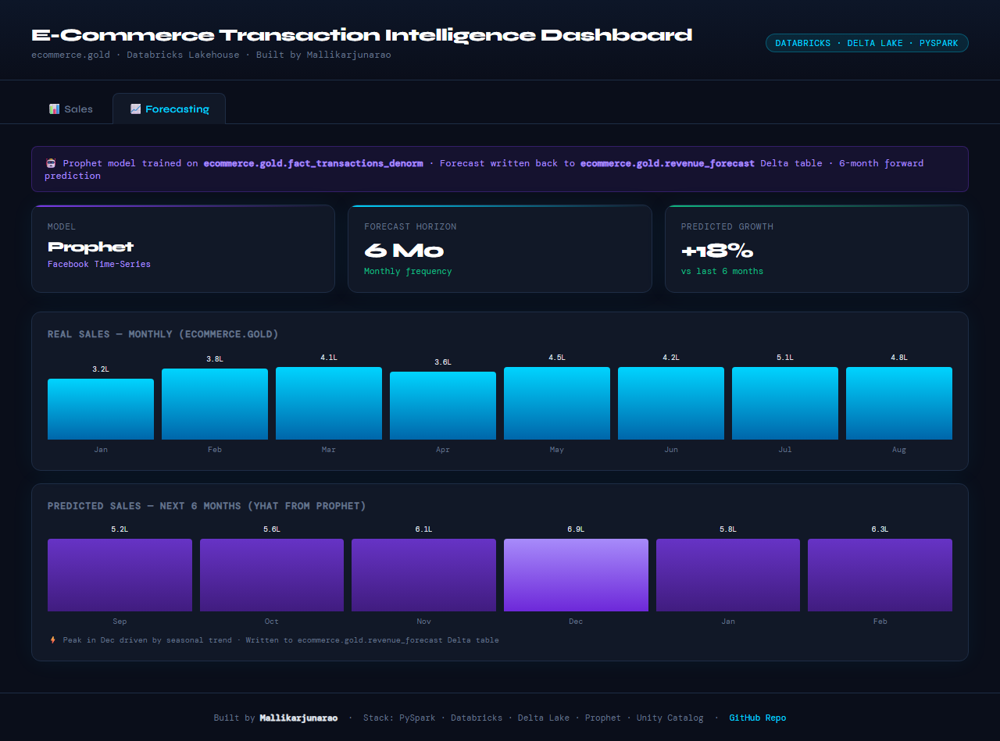

# E-Commerce Lakehouse on Databricks

An end-to-end **medallion lakehouse** on Databricks that turns raw, messy e-commerce CSV files into a BI-ready star schema, a sales dashboard and a six-month revenue forecast.




## Highlights

- **Unity Catalog layout:** one `ecommerce` catalog with `bronze`, `silver` and `gold` schemas, so every stage has a clear, debuggable boundary.
- **Traceable ingestion:** explicit schemas on every CSV read, plus lineage columns recording the source file and ingest time.
- **Real data-quality fixes:** duplicates, nulls, misspellings, mixed date formats, currency symbols, comma decimals and negative values are all handled in the silver layer.
- **Star schema:** product, customer and date dimensions around an order-items fact table, with net amounts normalised to INR across 7 currencies.
- **Forecasting on the gold layer:** a Prophet model predicts six months of revenue and writes the result back as a Delta table for the dashboard.

## How the layers work

### Bronze: raw, typed and traceable

Each notebook reads CSVs from a Unity Catalog Volume (`/Volumes/ecommerce/source_data/raw/<entity>/`) with an explicit `StructType` schema. It adds the source file path (from `_metadata.file_path`) and an ingest timestamp, then writes a Delta table.

`brz_brands` · `brz_category` · `brz_products` · `brz_customers` · `brz_calendar` · `brz_order_items`

### Silver: cleaned and standardised

| Table | What gets fixed |
| :-- | :-- |
| `slv_brands` | Trims brand names, strips non-alphanumeric characters from `brand_code`, maps category-code anomalies (`GROCERY` → `GRCY`, `BOOKS` → `BKS`, `TOYS` → `TOY`) |
| `slv_category` | Removes duplicate category codes and upper-cases them |
| `slv_products` | Strips `g` from `weight_grams`, converts comma decimals in `length_cm`, upper-cases brand and category codes, fixes misspelled materials (e.g. `Coton` → `Cotton`), makes negative `rating_count` values positive |
| `slv_customers` | Drops rows with a null `customer_id` and fills missing phone numbers with `Not Available` |
| `slv_calendar` | Parses `dd-MM-yyyy` dates, removes duplicate dates, normalises `day_name` casing, fixes negative week numbers |
| `slv_order_items` | De-duplicates on `(order_id, item_seq)`, converts `"Two"` to `2`, strips `$` and `%` from prices and discounts, lower-cases coupon codes, maps channels (`web` → `Website`, `app` → `Mobile`), parses dates and two timestamp formats, casts numeric columns |

### Gold: BI-ready star schema

| Table | Contents |
| :-- | :-- |
| `gld_dim_products` | Products joined to brand and category names (SQL `CREATE TABLE AS`), with `Not Available` for unmatched codes |
| `gld_dim_customers` | Customers with a `region` derived from a country and state mapping for India, the US, the UK, Australia, Canada, the UAE and Singapore (`Other` when unmapped) |
| `gld_dim_date` | `date_id` key (`yyyyMMdd`), month name, weekend flag, quarter and week |
| `gld_fact_order_items` | One row per order line: gross amount, discount, tax, **net amount** (gross − discount + tax), coupon flag, `date_id`, and `net_amount_inr` converted with fixed FX rates for INR, USD, GBP, AED, AUD, CAD and SGD |

### Forecasting

[`Forecasting/forcasting.py`](project_ecommerce/Forecasting/forcasting.py) aggregates monthly revenue from `gold.fact_transactions_denorm`, fits a Prophet model, predicts six months ahead and saves the result to `gold.revenue_forecast`.

## Dashboard

A Databricks SQL dashboard with **Sales** and **Forecasting** pages runs on the gold tables. The screenshots below come from the static preview in [`dashboard_preview.html`](dashboard_preview.html).





## Repository structure

```text
project_ecommerce/
├── 1_setup/                        # create the ecommerce catalog and bronze/silver/gold schemas
├── 1_medallion_processing_dim/     # dimensions: 1_dim_bronze → 2_dim_silver → 3_dim_gold
├── 3_medallion_processing_fact/    # order-items fact: 1_fact_bronze → 2_fact_silver → 3_fact_gold
└── Forecasting/forcasting.py       # Prophet revenue forecast
sql/schema_creation.sql             # schema DDL
dashboard_preview.html              # static preview of the Databricks SQL dashboard
docs/                               # images used in this README
```

## Run it yourself

1. In a Databricks workspace with Unity Catalog, import the notebooks in `project_ecommerce/`.
2. Run the notebook in `1_setup/` to create the `ecommerce` catalog and its `bronze`, `silver` and `gold` schemas.
3. Create the Volume `ecommerce.source_data.raw` and upload the source CSVs into `brands/`, `category/`, `products/`, `customers/`, `date/` and `order_items/landing/`. The source data isn't included in this repository.
4. Run the dimension notebooks in order (`1_dim_bronze`, `2_dim_silver`, `3_dim_gold`), then the fact notebooks (`1_fact_bronze`, `2_fact_silver`, `3_fact_gold`).
5. Create `gold.fact_transactions_denorm`, a denormalised view of the fact table joined to its dimensions. The forecast notebook reads it, but its definition isn't in this repository yet.
6. Run `Forecasting/forcasting.py`. It installs Prophet with `%pip`.

## Tech stack

Databricks · Unity Catalog · PySpark · Delta Lake · Databricks SQL · Prophet · pandas

## Author

**Mallikarjuna Rao Potti** · [GitHub](https://github.com/MallikarjunaRaoPotti) · [Portfolio](https://portfolio-p5o1.vercel.app) · [LinkedIn](https://www.linkedin.com/in/mallikarjuna7)
